<h1 align="center">Honeypot SOC on AWS</h1>

<p align="center">
<b>I left a fake server on the internet. Visitors from around the world found it, and some acted like attackers. My lab recorded, scored and documented the main case.</b>
</p>

<p align="center">


</p>

<p align="center">
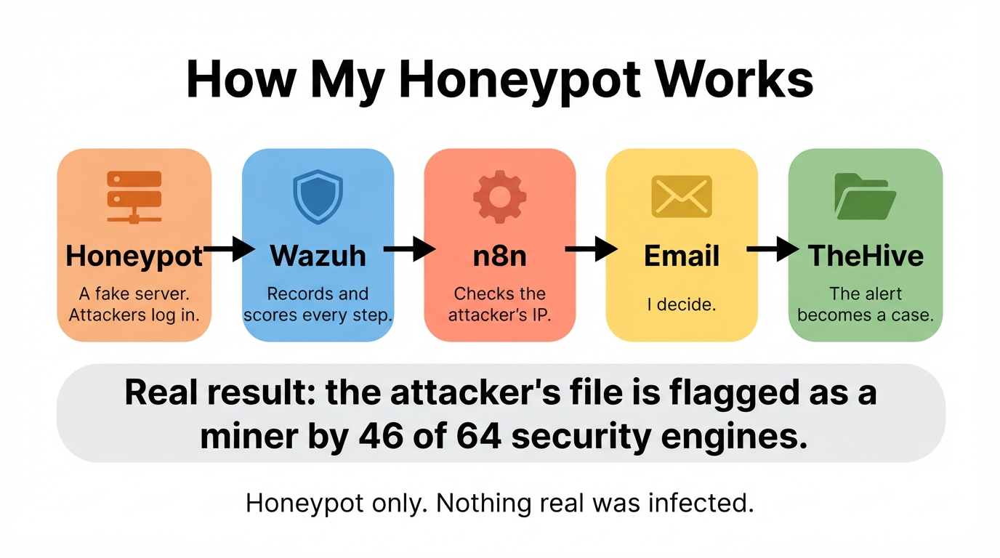
</p>

<p align="center">
<a href="Honeypot_SOC_Report.pdf"><b>📄 Read the full report (PDF)</b></a>
&nbsp;|&nbsp;
<a href="video/honeypot_demo.mp4"><b>▶ Watch the demo video</b></a>
</p>

---

## What is this project?

A honeypot is a fake computer that exists only to be attacked. Mine pretends to be an SSH server on Amazon Web Services. Every action a visitor takes is recorded, given a danger level by my own Wazuh rules, checked on AbuseIPDB and VirusTotal, and stored as an alert in TheHive by an n8n workflow.

A note on words: I call IP addresses that only connected **visitors**, and the ones that logged in or tried to log in **attackers**. An IP address is not a person, so I describe behaviour and do not accuse anyone.

This is a student SOC lab. The traffic is real, but the server is a decoy. Nothing real was infected, I never ran an attacker's file, and no IP address was blocked.

## Highlights

| 152 | 83 | 8 | 3 | 46 / 64 |
|:---:|:---:|:---:|:---:|:---:|
| connections | different IP addresses | logins from 6 IP addresses | IP addresses uploaded a file | vendors flag the main attacker's file as a miner |

Data period: 18 to 25 October 2026.

- Built a lab with three servers, two separate networks and locked down firewalls.
- Built a pipeline that works from start to end: Cowrie, Wazuh, n8n, then TheHive and email.
- Recorded a full case from 178.128.183.16: a weak password login, a Linux file upload, and a command to start it.
- Documented that case as TheHive case 5 and closed it as True Positive.

**Contents:** [Architecture](#architecture) · [How it works](#how-it-works) · [Safety](#safety) · [Results](#results) · [Main case](#main-case) · [Other attackers](#other-attackers) · [Challenges](#challenges-i-solved) · [Limits and next steps](#limits-and-next-steps) · [Details](#details) · [Folder structure](#folder-structure)

---

## Architecture

<p align="center">
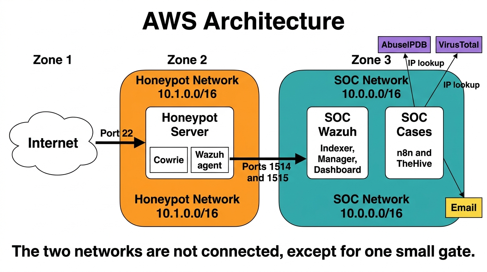<br>
<i>Two separate networks. The only link is one small gate for logs.</i>
</p>

| Server | Size | Job |
|---|---|---|
| Honeypot Server | t3.small, 20 GiB disk | Runs Cowrie in Docker and the Wazuh agent. This is the bait. |
| SOC Wazuh | m7i flex large, 60 GiB disk | Runs the Wazuh indexer, manager and dashboard |
| SOC Cases | m7i flex large | Runs TheHive and n8n in Docker |

- The **SOC Network** (10.0.0.0/16) and the **Honeypot Network** (10.1.0.0/16) are not connected.
- The only link is ports 1514 and 1515, used to send logs from the honeypot to Wazuh.
- Each server has its own Elastic IP, so its address stays the same after a restart.
- My dashboards accept connections only from my own IP address.

<p align="center">
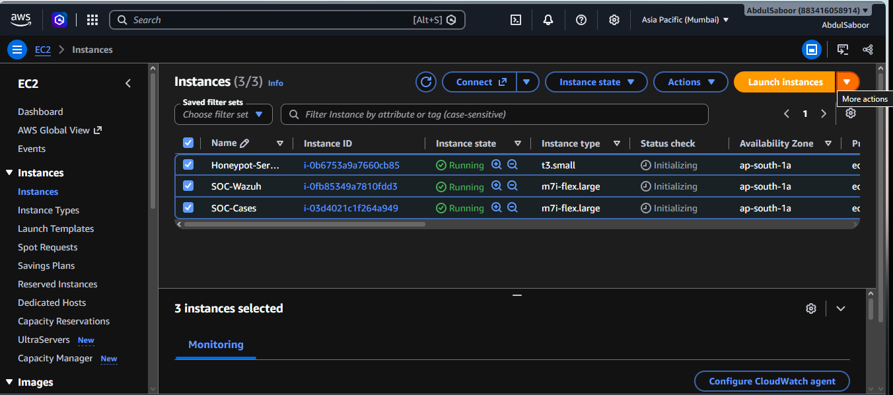<br>
<i>The three servers in AWS</i>
</p>

<table>
<tr>
<td>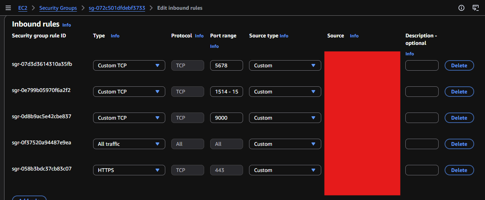</td>
<td>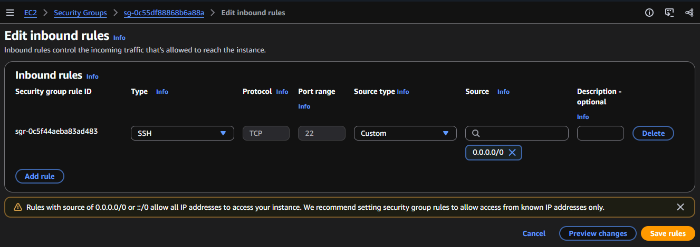</td>
</tr>
<tr>
<td align="center"><i>SOC firewall, inbound rules</i></td>
<td align="center"><i>Honeypot firewall, only port 22 is open</i></td>
</tr>
</table>

## How it works

1. A visitor connects to port 22. Cowrie answers like a real SSH server and writes every action to a log file.
2. The Wazuh agent sends each line to the Wazuh manager.
3. My rules give each event a level from 3 to 12. Wazuh adds the country.
4. Events of level 10 and above go to n8n.
5. n8n removes repeats and asks AbuseIPDB and VirusTotal about the IP address.
6. Important events become an alert in TheHive. The most serious ones also send me an approval email.
7. If I approve, the alert becomes a case. **No step blocks an IP address.**
8. A second workflow emails me a daily summary.

<p align="center">
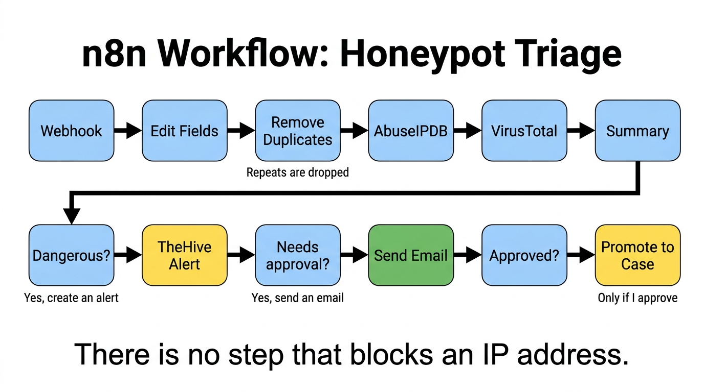<br>
<i>The n8n workflow as a diagram</i>
</p>

<p align="center">
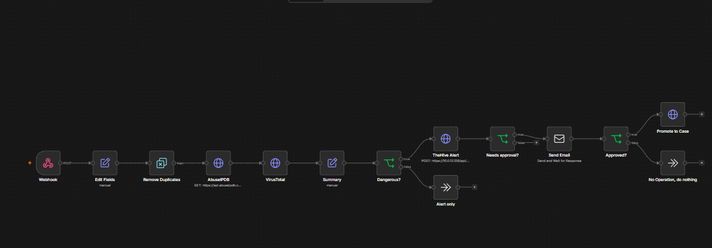<br>
<i>The Honeypot Triage workflow in n8n</i>
</p>

<table>
<tr>
<td>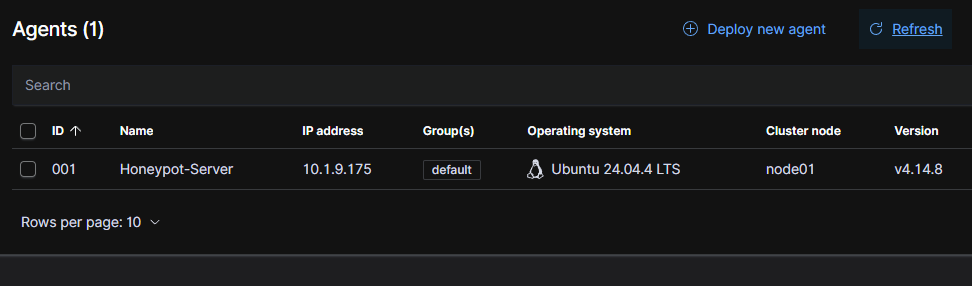</td>
<td>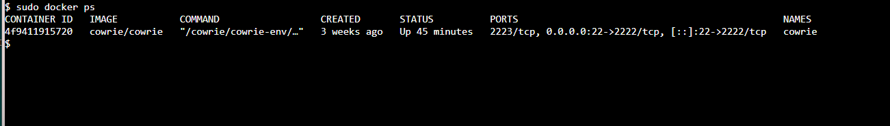</td>
</tr>
<tr>
<td align="center"><i>The honeypot agent is connected to Wazuh</i></td>
<td align="center"><i>Cowrie running in Docker on port 22</i></td>
</tr>
</table>

<p align="center">
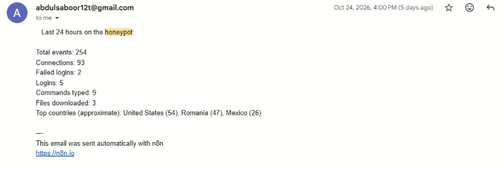<br>
<i>A daily summary email</i>
</p>

## Safety

- The honeypot only receives connections. I never opened or ran a file an attacker uploaded. I only looked up its SHA256 fingerprint on VirusTotal.
- The honeypot has its own network with no link to my other servers.
- The honeypot can send traffic out only on port 443 and the two Wazuh ports.
- The real SSH service on the honeypot server is switched off. I use the AWS browser terminal to work on it.
- The Docker container is not privileged and shares only its own volumes.
- The AWS metadata service on the honeypot is set to IMDSv2 only, so a program in the container cannot read the server's AWS role.
- I set a monthly cost budget with an email alert, and I never type a real password into the honeypot.

## Results

<p align="center">
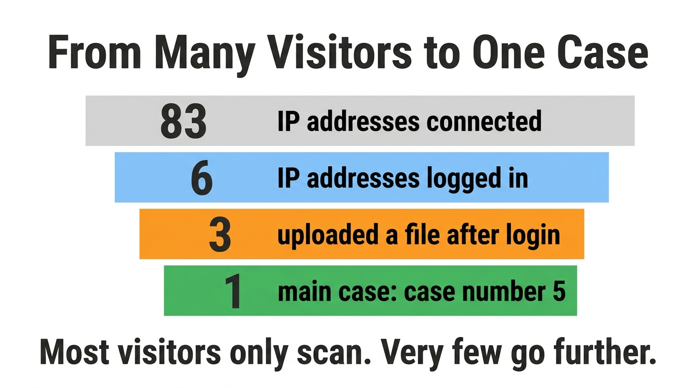<br>
<i>From many visitors to one main case</i>
</p>

I searched Wazuh from 12 to 30 October. The honeypot's agent first started on 17 October, the first outside visitor came on 18 October, and the last one on 25 October at 16:17. The honeypot was not running all the time. My own test connections are excluded.

Most visitors only connected and left within seconds, so I read them as internet scanners. Of the 83 IP addresses, **76 only connected and never tried a login**. The other 7 tried to log in or did log in.

<p align="center">
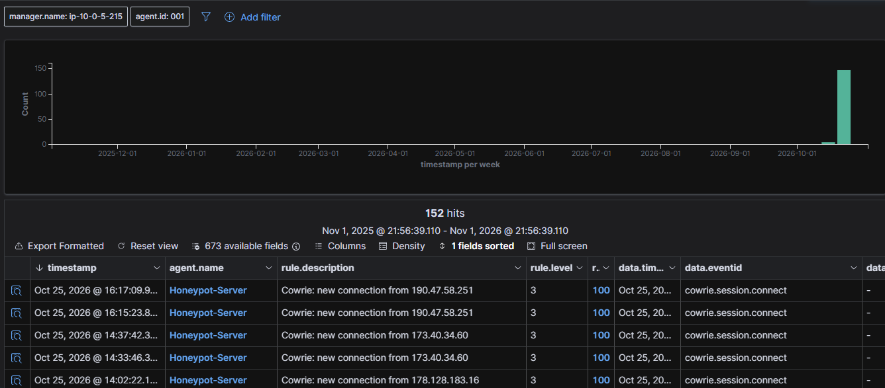<br>
<i>Wazuh: 152 connections in the data period</i>
</p>

**All 8 logins** (every one used a default or weak password)

| # | Time | IP address | Country | Login |
|---|---|---|---|---|
| 1 | 21 Oct, 12:21 | 34.79.89.168 | not checked | admin, admin |
| 2 | 23 Oct, 23:44 | 202.104.14.68 | China | root, debian |
| 3 | 24 Oct, 05:15 | 92.118.39.71 | Romania | root, !root |
| 4 | 24 Oct, 05:17 | 92.118.39.71 | Romania | root, 111111 |
| 5 | 24 Oct, 05:19 | 92.118.39.71 | Romania | root, 123123 |
| 6 | 24 Oct, 09:00 | 166.88.33.16 | United States | root, ubuntu |
| 7 | 24 Oct, 21:42 | 92.118.39.77 | Romania | root, !root |
| 8 | 25 Oct, 14:02 | 178.128.183.16 | United States | root, ubuntu |

The countries in this table come from the TheHive alert tags. Wazuh shows a country only for events after 24 October at 16:20, when I added the location processor.

<p align="center">
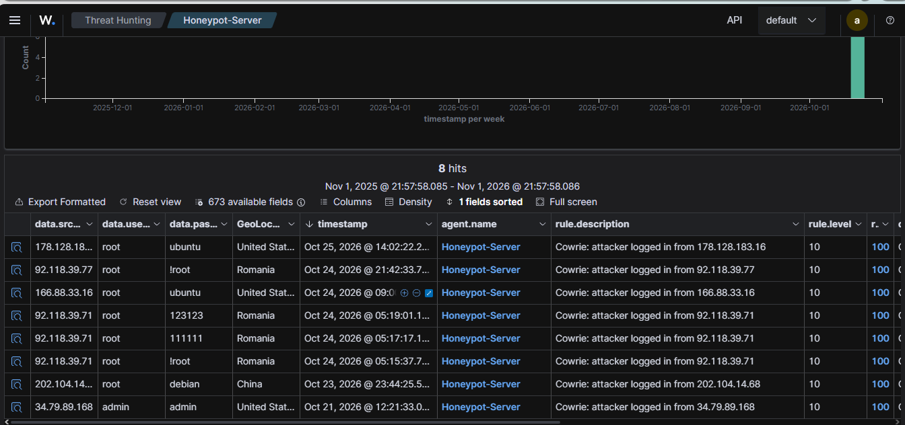<br>
<i>All successful logins in Wazuh</i>
</p>

<p align="center">
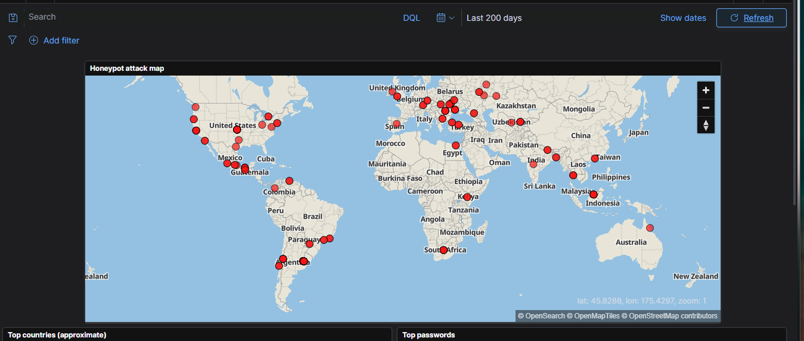<br>
<i>Connections by country, 24 October 16:20 to 25 October 16:17</i>
</p>

## Main case

**Attacker 178.128.183.16**

| Item | Value |
|---|---|
| IP address | 178.128.183.16 |
| Location | United States, Santa Clara, California |
| Network | DigitalOcean, LLC, AS14061 (data center and web hosting) |
| Session | 0f14d801afa9, about 4 minutes 26 seconds |
| Login | root with the password ubuntu, accepted on the first try |
| Behaviour | No failed logins and a fixed pattern. It looks automated. This is my reading. |

### What it did, on 25 October

<p align="center">
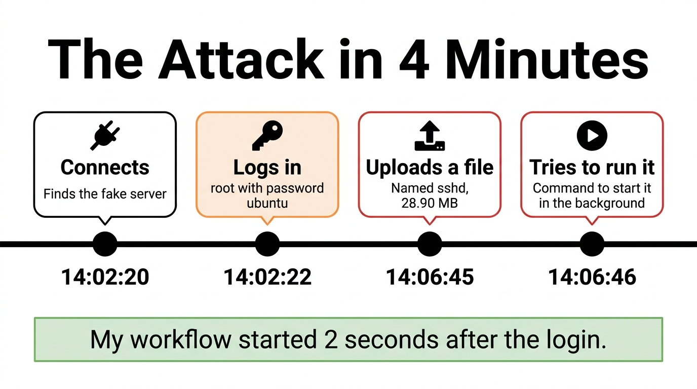<br>
<i>The attack in four minutes</i>
</p>

| Time | What happened | Rule | Level |
|---|---|---|---|
| 14:02:20 | New SSH connection | 100101 | 3 |
| 14:02:22 | Logged in as root with the password ubuntu | 100103 | 10 |
| 14:02:24 | My n8n workflow started | none | none |
| 14:06:45 | Uploaded a 28.90 MB file named sshd | 100100 | 3 |
| 14:06:46 | Ran a command to start it | 100104 | 10 |
| 14:06:46 | Session closed | 100100 | 3 |

These are the times in Cowrie's own log. Wazuh shows the same events up to two seconds later.

<p align="center">
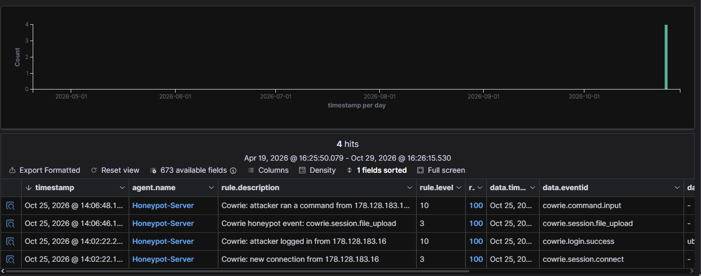<br>
<i>The four key events of session 0f14d801afa9</i>
</p>

### The command

```
chmod +x ./.9086028772874034665/sshd; nohup ./.9086028772874034665/sshd <46 IP addresses> &
```

| Part | What it means | Why it looks suspicious |
|---|---|---|
| ./.9086028772874034665/ | A folder whose name starts with a dot | A hidden folder |
| sshd | The file name | Copies the name of the real SSH service |
| chmod +x | Makes the file runnable | Activates the uploaded file |
| nohup | Keeps a program running after logout | It keeps running after the attacker leaves |
| & | Runs it in the background | It stays quiet |
| 46 IP addresses | Extra information given to the program | Looks like a peer list for a mining botnet. This is my reading. |

I do not print the 46 addresses, because some may belong to ordinary infected computers. Cowrie only plays commands, so the file never really ran.

<table>
<tr>
<td>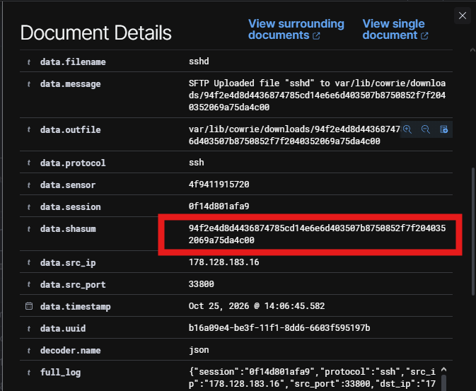</td>
<td>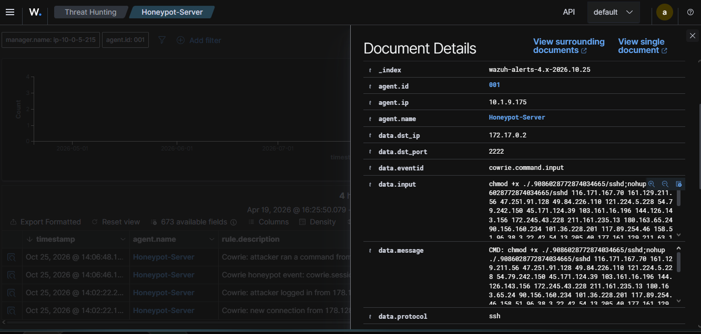</td>
</tr>
<tr>
<td align="center"><i>The upload event with the file name and SHA256</i></td>
<td align="center"><i>The command event</i></td>
</tr>
</table>

### The uploaded file

| Item | Value |
|---|---|
| SHA256 | `94f2e4d8d4436874785cd14e6e6d403507b8750852f7f2040352069a75da4c00` |
| Type and size | ELF 64 bit Linux file, 28.90 MB |
| VirusTotal | **46 of 64** vendors flag it as malicious |
| Threat label | miner.genericrxss/multiverze (categories miner, trojan, pua) |
| Kaspersky | HEUR:Trojan.Linux.Miner.gen |
| ESET | Linux/CoinMiner.ABF Trojan |
| Microsoft | Trojan:Linux/Multiverze!rfn |
| Sophos | Linux/Miner-AGY |

VirusTotal uses the words "miner" and "CoinMiner", so I call the file a cryptominer. I did not analyse the file myself.

<p align="center">
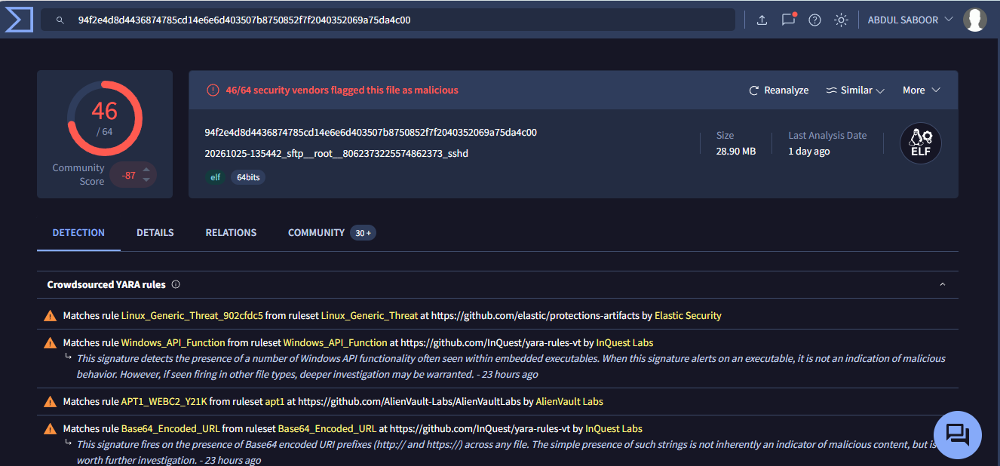<br>
<i>VirusTotal result for the uploaded file</i>
</p>

### What the IP looks like online

| Source | At alert time (25 October) | When I checked (29 October) |
|---|---|---|
| AbuseIPDB | Score 100, 1,127 reports | 100 percent, 1,662 reports from 591 sources |
| VirusTotal (IP) | 10 engines | 9 of 92 vendors |

These numbers grow over time, and both sets are real. AbuseIPDB shows the IP was first reported on 5 January 2026 and again a few hours before I checked, so it is still active. It was reported for SSH brute force, port scans and hacking.

<table>
<tr>
<td>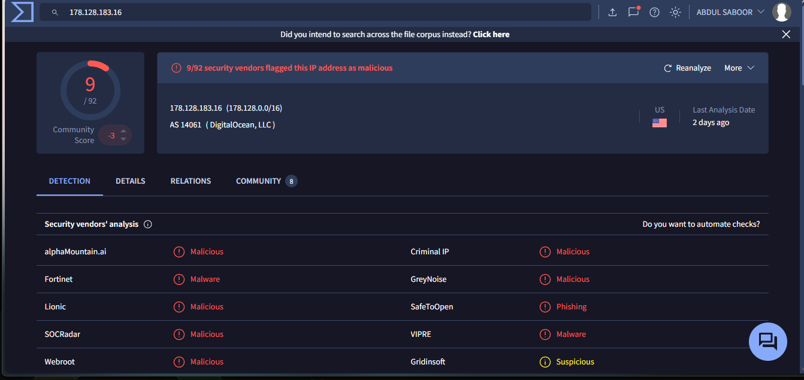</td>
<td>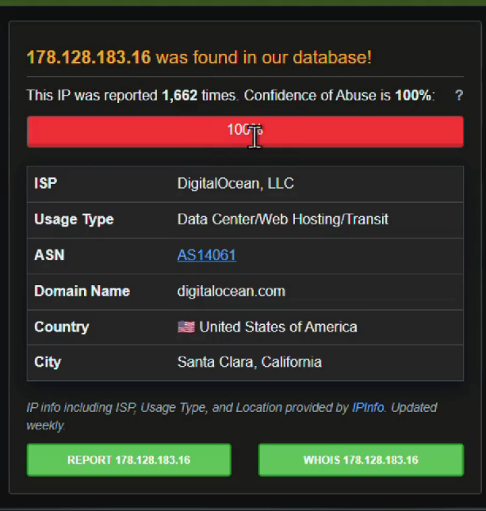</td>
</tr>
<tr>
<td align="center"><i>VirusTotal: the attacker IP</i></td>
<td align="center"><i>AbuseIPDB: the attacker IP</i></td>
</tr>
</table>

### How my pipeline responded

- Wazuh raised a level 10 alert at the login, and my n8n workflow started about two seconds later.
- n8n checked the IP, created the TheHive alert "Cowrie: attacker logged in from 178.128.183.16" (severity High, one observable), and emailed me "Honeypot attacker 178.128.183.16 needs approval".
- I did not click the approval email for this alert. On 29 October 2026, four days after the attack, I created **case 5** from the alert myself. I added the upload and the command to the description, started the case and closed it as True Positive. It is a honeypot, so there was no real impact.
- No IP address was blocked.

<p align="center">
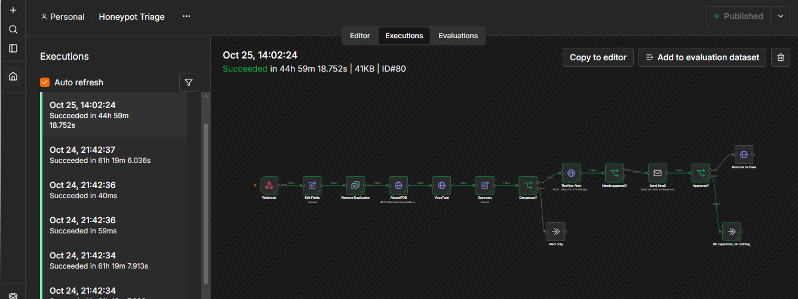<br>
<i>n8n runs for 25 October</i>
</p>

<p align="center">
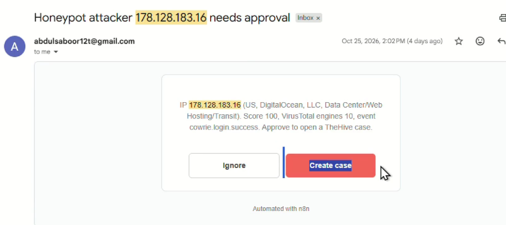<br>
<i>The approval email</i>
</p>

<table>
<tr>
<td>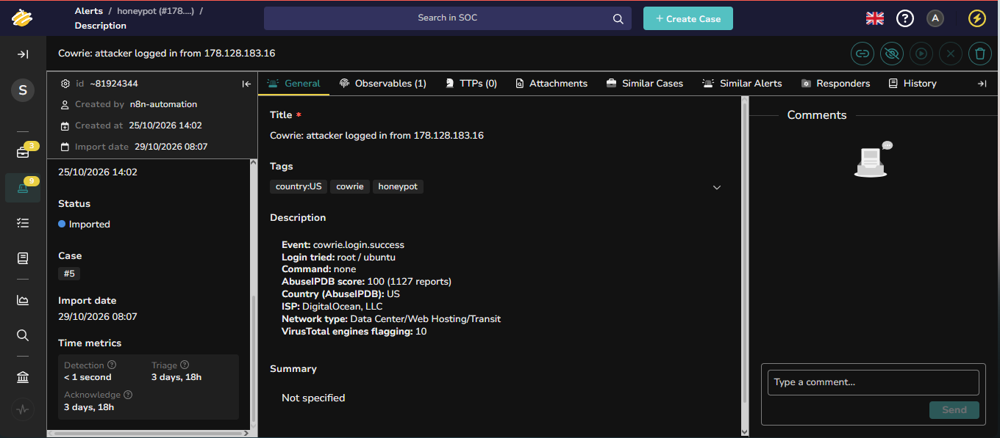</td>
<td>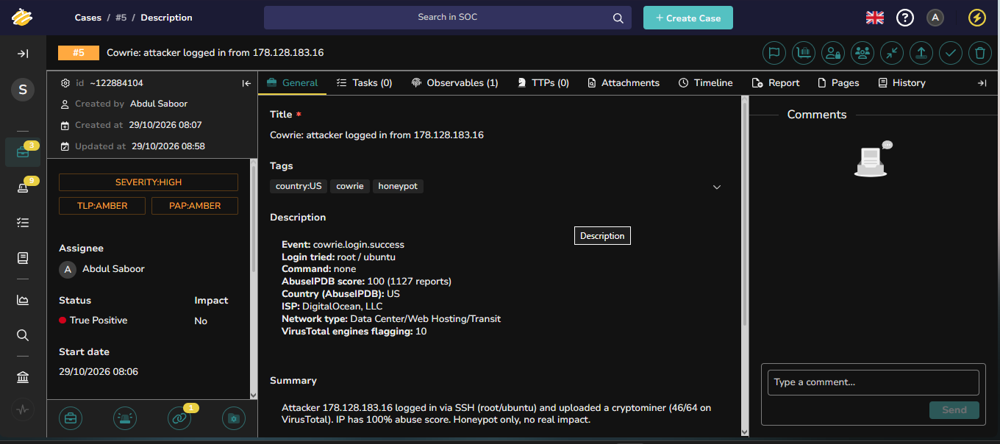</td>
</tr>
<tr>
<td align="center"><i>The TheHive alert</i></td>
<td align="center"><i>TheHive case 5</i></td>
</tr>
</table>

<p align="center">
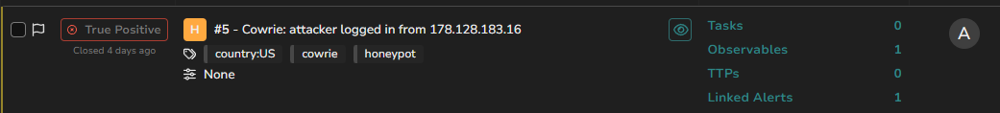<br>
<i>Case 5 closed as True Positive</i>
</p>

## Other attackers

### Three uploads after login

Three IP addresses logged in and then uploaded a file. For two of them the upload came almost exactly five minutes after the login. For the main case it came after 4 minutes and 23 seconds.

| IP address | Country | Login | Upload | VirusTotal |
|---|---|---|---|---|
| 202.104.14.68 | China | 23 Oct, 23:44 | 23 Oct, 23:49 | 42 of 65 vendors |
| 166.88.33.16 | United States | 24 Oct, 09:00 | 24 Oct, 09:05 | 36 of 62 vendors |
| 178.128.183.16 | United States | 25 Oct, 14:02 | 25 Oct, 14:06 | 46 of 64 vendors |

All three files have different fingerprints, and many vendors flag all three. I analysed only the third one in detail.

<p align="center">
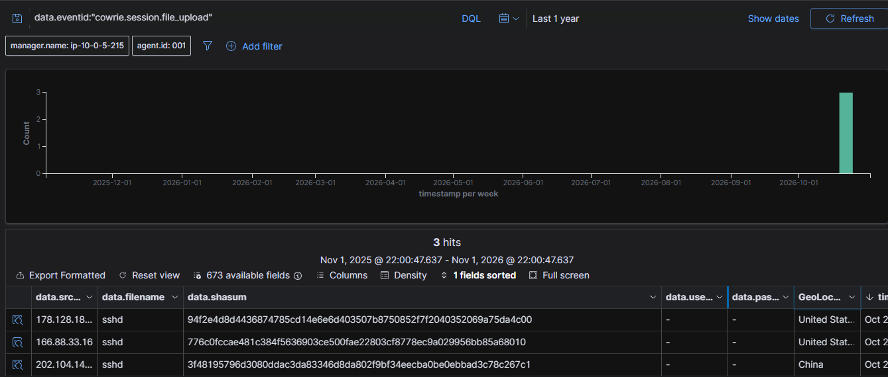<br>
<i>The three upload events in Wazuh</i>
</p>

<table>
<tr>
<td></td>
<td>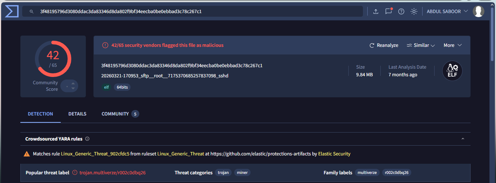</td>
</tr>
<tr>
<td align="center"><i>File from 166.88.33.16, 36 of 62</i></td>
<td align="center"><i>File from 202.104.14.68, 42 of 65</i></td>
</tr>
</table>

### Two IP addresses in Romania

The IP addresses 92.118.39.71 and 92.118.39.77 belong to the same hosting company, DMZHOST. They logged in as root with the password `!root`, and 92.118.39.71 also used `111111` and `123123`. Each session first ran a long script that collects the system's name, CPU, graphics card and recent logins. Then it ran a tiny script that creates a file named `filter`, runs it and deletes it.

The `filter` file has the SHA256 `af77b643964afd794460d28ab8a11b0ec8790cd5463abfde126613a4f3bccd32`, and no VirusTotal vendor flags it. The same fingerprint appeared in all four sessions, three from 92.118.39.71 and one from 92.118.39.77. My reading is that the bot tests whether the machine is a real computer or a honeypot. Both IP addresses ran the same routine from the same hosting company, so I think they belong to one campaign. TheHive case 4 is for 92.118.39.71.

<table>
<tr>
<td>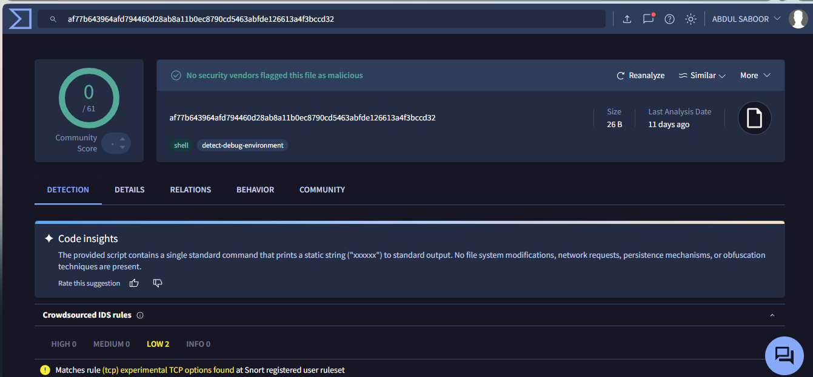</td>
<td>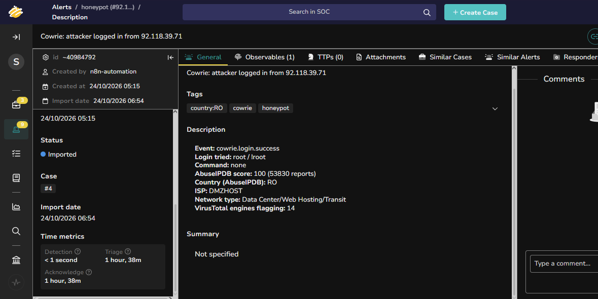</td>
</tr>
<tr>
<td align="center"><i>The filter script, no vendor flags it</i></td>
<td align="center"><i>TheHive case 4 for 92.118.39.71</i></td>
</tr>
</table>

## Challenges I solved

- Installed Wazuh after two failed attempts, caused by a package lock and a half removed package.
- Made Wazuh show a country for each visitor, by adding a Filebeat processor for Cowrie's field name.
- Wrote my own Wazuh rules from the real field names, using the Ruleset Test page.
- Fitted TheHive and its database into an 8 GiB server by lowering their memory limits.
- Connected n8n to TheHive and to the Wazuh indexer, and fixed JSON and request method errors.

**Skills practised:** cloud networking and firewalls, log collection, detection rules, automation, threat intelligence lookups, case management and incident documentation.

## Limits and next steps

**Limits**
- The honeypot recorded visitors for one week, and it was not running all the time.
- Cowrie only plays commands, so I cannot say what an uploaded file would really do. The words "miner" and "botnet" are my reading of VirusTotal's labels and of the IP list.
- AbuseIPDB and VirusTotal numbers change over time, and locations are approximate.
- An IP address is not a person. Many of these addresses belong to rented servers, so I describe behaviour and do not accuse anyone.

**Next steps**
1. Add a Wazuh rule at level 12 for file uploads. Today they are level 3 and make no alert.
2. Look into the n8n run at 14:06:49, one second after the attacker's command. It ended with an error, and I have not found the cause yet.
3. Give the approval email a longer wait and a reminder.
4. Run the honeypot for several weeks and compare the results.

## Details

<details>
<summary><b>MITRE ATT&CK mapping (my own assessment)</b></summary>

| Technique | Evidence |
|---|---|
| T1021.004 Remote Services: SSH | SSH connection to port 22 |
| T1078 Valid Accounts | Login as root with the password ubuntu |
| T1105 Ingress Tool Transfer | File uploaded over the SSH connection |
| T1222.002 File Permissions Modification | chmod +x |
| T1564.001 Hidden Files and Directories | Folder name starts with a dot |
| T1036.005 Masquerading | File named sshd |
| T1496 Resource Hijacking | VirusTotal label: miner |

</details>

<details>
<summary><b>Indicators of compromise</b></summary>

| Type | Value |
|---|---|
| IP address | 178.128.183.16 (DigitalOcean, AS14061) |
| SHA256 | `94f2e4d8d4436874785cd14e6e6d403507b8750852f7f2040352069a75da4c00` |
| File name | sshd, 28.90 MB, ELF 64 bit |
| Hidden folder | `./.9086028772874034665/` |
| Login | root with the password ubuntu |
| Other upload fingerprints | `776c0fccae481c384f5636903ce500fae22803cf8778ec9a029956bb85a68010` (166.88.33.16), `3f48195796d3080ddac3da83346d8da802f9bf34eecba0be0ebbad3c78c267c1` (202.104.14.68) |
| Test script fingerprint | `af77b643964afd794460d28ab8a11b0ec8790cd5463abfde126613a4f3bccd32` |

</details>

<details>
<summary><b>My Wazuh rules for Cowrie</b></summary>

| Rule ID | What it matches | Level |
|---|---|---|
| 100100 | Any Cowrie event | 3 |
| 100101 | New connection | 3 |
| 100102 | Failed login | 5 |
| 100103 | Successful login | 10 |
| 100104 | Command input | 10 |
| 100105 | File saved (Cowrie calls it a file download) | 12 |

</details>

<details>
<summary><b>Tools used</b></summary>

| Tool | Its job in this project |
|---|---|
| AWS | Hosts everything in two separate networks |
| Cowrie | Pretends to be an SSH server and records every step |
| Wazuh 4.14.8 | Applies my rules and gives each event a level from 3 to 12 |
| n8n 2.43.7 | Removes repeats, checks the IP, creates the alert, sends the email |
| AbuseIPDB | Gives an abuse score from user reports |
| VirusTotal | Shows how many security engines flag an IP or a file |
| TheHive 5.8.1 | Stores alerts and cases |

</details>

## Folder structure

```
Honeypot_SOC/
├── README.md
├── Honeypot_SOC_Report.pdf
├── diagrams/        5 diagrams
├── screenshots/     26 screenshots
└── video/           honeypot_demo.mp4
```

## Author

**Abdul Saboor**, BS Computer Science (CUST Islamabad), aspiring IT Support and SOC analyst.
[GitHub](https://github.com/abdulsaboor85) · [LinkedIn](https://www.linkedin.com/in/abdul-saboor-082866290/)

This project was built for learning on a decoy system. Do not run attacker files on a real computer.