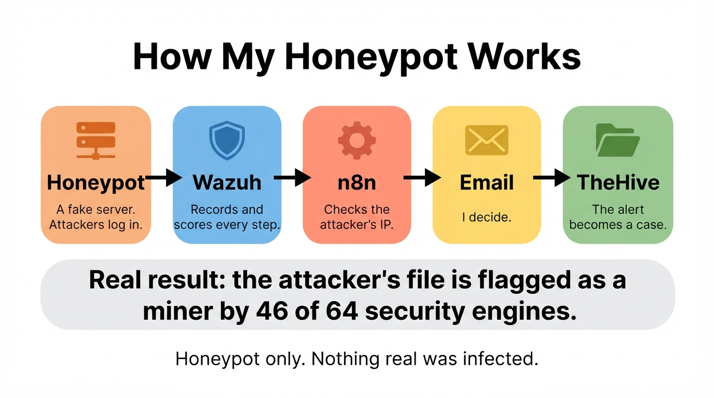

# 🛡️ SOC Journey

### Cybersecurity portfolio: hands on labs built from scratch, broken, debugged, and confirmed working

*BS Computer Science, Final Year*
*Capital University of Science and Technology (CUST), Islamabad*

---

---

## ⭐ Featured project: Honeypot SOC on AWS

I left a fake server open on the internet for one week. **152 connections from 83 IP addresses** found it. Six of them logged in with weak passwords, and one uploaded a file that **46 of 64 security vendors** flag as a miner. My pipeline (Cowrie, Wazuh, n8n and TheHive) recorded it, scored it and documented it as a case.

[📄 Read the project](./Honeypot_SOC/) · [🛠 Setup guide](./Honeypot_SOC/SETUP.md) · [▶ Demo video](./Honeypot_SOC/video/honeypot_demo.mp4)

---

## 📁 Projects

| # | Project | What It Covers | Status |
|---|---|---|---|
| 1 | [Enterprise IAM Lab](./IAM/) | Active Directory, SSO, RBAC, VPN, 2FA | ✅ Complete |
| 2 | [Snort IDS Lab](./Snort/) | Intrusion Detection, Network Signatures | ✅ Complete |
| 3 | [Wazuh SIEM Lab](./Wazuh_Report/) | Log Analysis, Security Monitoring | ✅ Complete |
| 4 | [Wireshark Analysis](./wireshark/) | Packet Capture, Traffic Analysis | ✅ Complete |
| 5 | [Mini SOAR on AWS](./Mini-SOAR/) | Automated detection, threat enrichment, case management, and response using Wazuh, TheHive, n8n, and VirusTotal | ✅ Complete |
| 6 | [Honeypot SOC on AWS](./Honeypot_SOC/) ⭐ | A Cowrie honeypot on the internet, Wazuh rules, n8n enrichment with AbuseIPDB and VirusTotal, and TheHive cases. Real traffic recorded and documented. | ✅ Complete |

---

## 🔬 About This Repository

I built every lab in this repository myself, inside a virtualized environment, using the same tools real security teams use. My focus throughout has been understanding why these security controls exist, not just clicking through a setup guide.

Each project includes:
- A full explanation of what I built and why I built it that way
- The real problems I ran into while building it
- How I actually debugged those problems, using logs and evidence rather than guessing
- Screenshots and recordings showing the finished system actually working

---

## 🧰 Tools and Technologies Used Across All Labs

---

## 🤝 Connect

I am a final year student looking for IT Support and SOC analyst roles.
[GitHub](https://github.com/abdulsaboor85) · [LinkedIn](https://www.linkedin.com/in/abdul-saboor-082866290/)

---

*Built with patience, broken with curiosity, fixed with logs.*

---

## Disclaimer

Everything in this repository, every test, every demonstration, was done in an authorized lab or virtual environment purely for learning purposes. The honeypot only receives connections. I never attacked anyone.

Please do **not** use any technique, command, or tool shown here against a computer, network, or system that you do not own or do not have clear permission to test.
